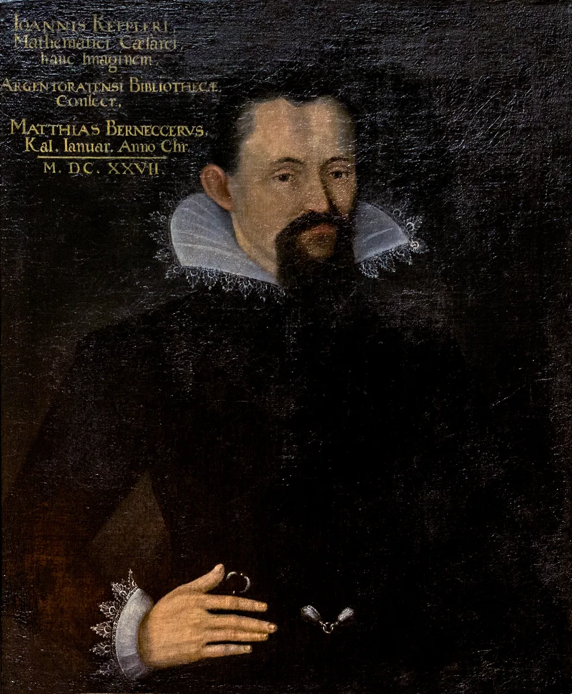

# 요하네스 케플러

## TL;DR

- **행성 운동의 「세 법칙」으로 기억되는 사람.** 궤도는 타원이고, 같은 시간에 같은 넓이를 쓸며, 주기의 제곱은 거리의 세제곱에 비례한다[1][13].
- **그런데 그는 그것을 셋으로 묶어 내놓은 적이 없다.** 둘째를 먼저 찾았고[2][3], 세 법칙은 1609~1621년 세 권의 책에 흩어져 나왔다[4]. 「법칙」이라는 이름은 1738년 볼테르가, 셋이라는 묶음은 1804년 스몰이 붙였다[4].
- 스탠퍼드 백과는 그가 그것을 「법칙」으로 이해했을지부터 **의문**이라고 적는다[2]. 스몰이 붙인 「경험 법칙」이라는 딱지는 위키백과가 「역사에 반한다」고 적는데[4], 오늘 국내 백과의 정의에 그대로 남아 있다[13].
- **얼굴도 그렇다.** 오래 그의 초상으로 돌던 「1610년 초상」은 19세기 위작으로 보인다는 연구가 있다[8]. 위의 그림은 1627년 스트라스부르 도서관에 들어간, 확실하다고 꼽히는 초상이다[8][9].
- 이 서가에서 그는 8편 40번 불린다(이 노트를 쓰기 전 2026-11-03 에 센 값, 이 노트의 셈). [[니콜라우스 코페르니쿠스]] 노트에서 그는 **오지안더의 이름을 활자로 밝힌 사람**이다.

---

## 1. 여관의 아이, 튀빙겐의 신학생

1571년 12월 27일 바일데어슈타트에서 났다[1][3]. 아버지는 용병이었고 그가 다섯 살 때 집을 떠나 네덜란드 전쟁에서 죽은 것으로 **여겨진다**[1]. 어린 그는 할아버지의 여관에서 어머니와 살며 일을 도왔다[1].

튀빙겐에서는 성직자가 되려고 신학을 공부했다[1][12]. 거기서 **메스틀린**이 몇몇 학생에게만 코페르니쿠스 체계를 가르쳤고, 그도 그 하나였다[1]. MacTutor 는 그가 『천구의 회전에 관하여』의 「수학일 뿐」이라는 머리말이 코페르니쿠스의 것이 **아님**을 메스틀린에게서 배웠다고 적는다[1]. 위키백과의 그 책 항목은 길을 두 가지로 적는다 — 슈라이버가 오지안더의 이름을 적어 둔 책이 메스틀린을 거쳐 케플러에게 갔다는 이야기와, 케플러가 그 메모로 알았고 **메스틀린이 케플러에게서 들었다**는 깅거리치의 이야기다[14]. 누가 누구에게 알려 주었는지가 자료마다 거꾸로다.

그는 성직을 접고 그라츠의 수학 교사가 됐다[1]. 1594년이다(인명사전은 「천문학 교수」로 적는다)[12]. MacTutor 는 그의 신앙이 정통 루터파와 맞지 않는다는 튀빙겐의 의심이 메스틀린이 그렇게 권한 **까닭일 수 있다**고 적는다[1].

## 2. 1596 — 다섯 입체

첫 책 『우주의 신비』(1596)는 묻는다 — 행성은 왜 여섯이고, 궤도 사이는 왜 그만큼 벌어져 있나[1]. 그의 답은 볼록 정다면체 다섯을 궤도의 구 사이에 끼우는 것이었다. 토성과 목성 사이에 정육면체, 목성과 화성 사이에 정사면체, 그다음 정십이면체 · 정이십면체 · 정팔면체[1]. 정다면체가 다섯뿐이라는 것은 유클리드 『원론』 13권이 증명한다[1] — 그래서 행성이 여섯이다.

MacTutor 는 그 모형이 코페르니쿠스의 값과 맞는 정도가 **가장 큰 오차가 10% 밑**이었다고 적는다[1]. 국내 천문학백과는 이 책의 해를 「1956년」으로 적는데[10], 1596 의 숫자가 뒤바뀐 것으로 보인다(이 노트의 읽기).

그는 그 책을 당대 최고의 관측자 **튀코 브라헤**에게 보냈다[1]. 1600년 1월 1일 프라하로 떠나 2월 4일 베나트키에서 그를 만났다[3]. 국내 인명사전은 프라하에 간 해를 1597년으로 적는다[12].

## 3. 화성과의 전쟁 — 둘째가 먼저

튀코는 화성을 맡겼다[1]. 1601년 튀코가 죽자 그는 황제 수학자 자리를 이었다[1]. 남은 원고는 거의 **천 장**의 계산이고, 그는 그 일을 「화성과의 전쟁」이라 불렀다[1].

**찾은 차례.** 위키백과와 스탠퍼드 백과는 같은 차례를 적는다.

- 그는 넓이를 재기 전에 태양이 행성을 미는 **원인**부터 세웠다[3]. 그 비례를 셈하기 쉽게 **1602년 말** 「같은 시간에 같은 넓이」로 바꿔 적었다 — 오늘의 제2법칙이다[3].
- 그 뒤 알 모양 궤도를 가정하고 **약 40번** 실패한 끝에 **1604년 말** 타원에 이르렀다 — 오늘의 제1법칙이다[3]. 스탠퍼드 백과도 그가 「먼저 제2법칙을 찾고 그 뒤 타원 궤도를」 찾았다고 적는다[2].

국내 천문학백과는 거꾸로 적는다 — 제일 먼저 안 것이 **타원**이고 그것이 1605년이며, 면적 속도의 법칙을 찾은 **뒤** 1609년에 발표했다는 것이다[10]. MacTutor 는 화성 작업이 1605년에 **사실상** 끝났다고 적는다[1]. 1605는 그 마무리의 해로 읽힌다(이 노트의 읽기).

번호는 오늘 붙은 것이다. 1번이 2번보다 두 해쯤 늦게 찾아졌다(1602 말 → 1604 말, 이 노트의 셈).

**8분.** 그가 세운 대리 가설에 **이심률을 반으로 나눈 값**을 넣자 관측과 **8분각** 어긋났다. 튀코의 관측 오차보다 큰 값이었다. 그는 적었다[5].

> 이 8분은 무시할 수 없었으므로, 이것만으로도 천문학 전체의 개혁으로 가는 길이 될 것이며, 이 책의 큰 부분이 그것을 다룬다[5].

8분각은 1도의 60분의 8, 곧 약 0.13도다(셈). 천문학백과는 튀코의 관측이 **2각분 정도**의 정확도를 가졌기에 가능했다고 적는다[10]. MacTutor 는 이 대목에서 **관측 오차**라는 개념이 처음 명시적으로 쓰였다고 본다[1].

타원에 이른 길도 곧지 않았다. 『새 천문학』 항목은 그가 극좌표 꼴의 타원식을 적어 놓고도 작도에서 실수해 다른 궤도를 얻었고, 다시 타원에 이르러서야 실수를 알았다고 적는다[5].

## 4. 세 권에 흩어진 세 법칙

| 오늘의 번호 | 찾은 때 | 실린 책 |
|---|---|---|
| 제1 타원 | 1604년 말 [3] · 1605 [10] | 『새 천문학』 1609 [1][4] |
| 제2 넓이 | 1602년 말 [3] | 『새 천문학』 1609 — 지금 꼴은 『개요』 1621 [4] |
| 제3 주기 | 1618년 5월 15일 [1] | 『세계의 조화』 1619 [1][4] |

오늘의 꼴로 적은 넓이 법칙은 행성과 태양을 잇는 선이 같은 시간에 같은 넓이를 쓴다는 것이다[1][13]. 아래 그림은 그것을 움직여 보인다 — 점의 자리는 이 노트가 케플러 방정식으로 셈했다.

![같은 시간, 같은 넓이 케플러의 넓이 법칙이라는 표제 아래, 한 바퀴를 같은 시간 열두 칸으로 나눈 자리에 푸른 점을 찍고 태양(주황 점, 초점)에서 그은 부채꼴을 차례로 채웠다는 설명이 있다. 크게 납작한 타원 위에 푸른 점 열두 개가 있고, 오른쪽 초점의 주황 점에서 이웃한 두 점으로 부채꼴 열두 개가 짙고 옅은 빛으로 번갈아 칠해진다. 오른쪽(태양에 가까운 쪽)의 부채꼴은 짧고 넓으며 호가 길고, 왼쪽(먼 쪽)의 부채꼴은 길고 가늘며 호가 짧다. 그림 아래에 태양에 가까운 오른쪽에서는 같은 시간에 호가 길고, 먼 왼쪽에서는 짧다, 넓이는 같다라고 적혀 있다. 맨 아래 단서 셋, 이심률 0.6 은 보이게 하려고 크게 잡았고 점의 자리는 케플러 방정식 M = E − e sin E 를 이 노트가 풀어 셈했다(이 노트의 셈)는 것, 열두 부채꼴의 넓이는 이 노트가 수치로 셈해 모두 같음을 확인했고 법칙의 내용은 본문의 출처를 따른다는 것, 부채꼴은 차례로 나타나지만 움직임을 끄거나 인쇄하면 열두 칸이 처음부터 모두 보인다는 것이 있다](../../assets/figures/kepler-equal-areas.svg)

위키백과는 그가 『새 천문학』에서 제2법칙을 **지금 꼴로 내놓지 않았다**고 적는다. 처음에는 원에 가까운 궤도에서만 맞는 「거리 법칙」이었고, 넓이 꼴은 1621년 『코페르니쿠스 천문학 개요』에서야 나왔다[4]. 『개요』의 해도 자료마다 다르다 — 위키백과 법칙 항목은 1621[4], 국내 물리학백과는 1618~1621[11]이다.

**셋째는 책이 인쇄에 들어간 뒤에 왔다**[1]. 그는 그 순간을 이렇게 적었다[1].

> 정확한 때를 알고 싶다면, 그것은 올해 1618년 3월 8일에 머릿속에 떠올랐지만 셈에 운이 없어 틀린 것으로 버려졌고, 마침내 5월 15일에 돌아와 … 내 마음의 어둠을 쳐부수었다. 처음에는 꿈을 꾸는 줄 알았다.

그가 쓴 자료로 직접 확인할 수 있다. 위키백과가 옮긴 1618년 값으로 R³/T² 를 셈하면 금성 7.52, 지구 7.50, 화성 7.50, 목성 7.49, 토성 7.43 이다(단위 10⁻⁶ AU³/일², 4번의 표)[4]. 지구 값을 다시 셈하면 1³ ÷ 365.25² × 10⁶ ≈ 7.496 이다(셈).

국내 인명사전은 법칙을 「케플러의 법칙(1601~21)」으로 한데 적는다[12]. 스무 해에 걸친 일을 한 이름 아래 둔 셈이다(이 노트의 읽기).

## 5. 이름이 붙은 차례

![그림 위쪽에 「번호는 나중에 붙었다 케플러」라는 표제가 있고 그 아래에 갈색은 케플러가 찾거나 쓴 것, 푸른색은 뒷사람이 붙인 이름, 빈 점은 차례가 다르게 적힌 자료라고 적혀 있다. 그림은 위아래 두 칸이다. 위 칸의 제목은 1600~1622 찾은 차례와 책에 실린 차례이고, 가로축에 1600부터 1620까지 다섯 해마다 눈금이 있다. 첫 줄은 찾은 때 (위키백과 · SEP · MacTutor)이다. 갈색 점이 셋 있고 왼쪽부터 1602 말 제2 넓이 법칙, 1604 말 제1 타원 약 40번 실패한 뒤, 1618.3.8 떠올렸다 버리고 5.15 제3 주기 법칙이라고 적혀 있다. 둘째 줄은 천문학백과의 차례로, 1605년 자리에 빈 갈색 점이 있고 1605 제1 타원을 먼저, 제2 넓이는 그 뒤라고 적혀 있다. 셋째 줄은 책에 실린 때로, 갈색 점 셋에 1609 『새 천문학』 제1 · 제2, 1619 『세계의 조화』 제3, 1621 『개요』 지금 꼴의 제2라고 적혀 있다. 아래 칸의 제목은 1600~1850 「세 법칙」이라는 이름이 붙기까지이고, 가로축에 1600부터 1850까지 쉰 해마다 눈금이 있으며 축 왼쪽 끝의 1600~1622 구간에 위 칸이라고 적힌 옅은 띠가 있다. 줄 위에 왼쪽부터 갈색 점 1609 『새 천문학』, 검은 점 1630.11.15 죽다, 푸른 점 1738 볼테르 처음으로 「법칙」, 푸른 점 1804 스몰 셋으로 묶어 「경험 법칙」, 푸른 점 1837 휴얼 「귀납의 천재」가 있다. 1609년 점에서 1804년 점까지 괄호가 걸쳐 있고 그 아래에 195년(이 노트의 셈), 위키백과 「거의 두 세기」라고 적혀 있다. 그 아래 푸른 글씨로 오늘의 사전, 「행성의 운동에 관한 세 개의 경험적 법칙」(13) · 「후대 천문학자들이 성문화」(11)라고 적혀 있다. 맨 아래에 단서가 넷 있다. 첫째, 「말」은 12월 첫머리, 해만 아는 책은 그 해 가운데에 두었고 3월 8일은 5월 15일과 너무 가까워 점을 따로 두지 않았다. 둘째, 찾은 때의 차례는 3번(위키백과)과 2번(SEP), 1618년 날짜는 1번(MacTutor)을 따랐고 10번(천문학백과)은 차례가 거꾸로다. 셋째, 195년은 이 노트가 1609와 1804의 해의 차로 셈했고 「적어도 랄랑드 때부터」라는 4번의 말은 해가 없어 점을 두지 않았다. 넷째, 제1 · 제2 · 제3 은 오늘의 번호이고 케플러가 매긴 번호가 아니며 괄호 숫자는 이 노트의 출처 번호다](../../assets/figures/kepler-numbered-later.svg)

위키백과는 지금의 형식이 자리 잡는 데 **거의 두 세기**가 걸렸다고 적는다[4].

- **1738** 볼테르의 『뉴턴 철학 요강』이 「법칙」이라는 말을 쓴 **첫 출판물**이다[4].
- 『천문학자 인명 백과』는 그 말이 **적어도 랄랑드 때부터** 쓰였다고 적는다[4].
- **1804** 로버트 스몰의 『케플러의 천문학적 발견에 관한 설명』이 **셋째를 더해** 세 법칙의 묶음을 만들었다[4]. 1609 에서 195년 뒤다(셈).

스몰은 하나를 더 붙였다. 위키백과는 그가 **「역사에 반해」** 그것이 귀납 추론에 바탕한 **경험 법칙**이라고 주장했다고 적는다[4]. 33년 뒤(셈) 휴얼은 1837년 『귀납적 과학의 역사』에서 그를 **귀납적 과학 천재의 전형**으로 평가했다[11].

그 딱지는 지금도 있다. 국내 천문학백과의 「케플러법칙」 항목은 그것을 「케플러가 밝힌 행성의 운동에 관한 세 개의 **경험적** 법칙」으로 정의하고, 그 법칙이 유명한 까닭으로 「**오직 관측 자료를 기초로** 만들었다」는 점을 든다[13]. 그런데 위의 §3 이 보여 주듯 그는 넓이를 재기 전에 **원인**부터 세웠다[3]. 물리학백과는 그 법칙을 그 자신이 아니라 **후대의 천문학자들이** 세 권의 책을 바탕으로 성문화했다고 적는다[11].

스탠퍼드 백과는 가장 조심스럽다 — 그가 이것들을 「법칙」으로 이해했을지는 **의문**이고, 그 낱말을 오늘과 다른 뜻으로 썼다고 볼 수도 있으며, 그래서 이 글은 「언어 관습으로」 그 말을 계속 쓴다는 것이다[2].

## 6. 얼굴 — 1610년 초상은 누구인가

「케플러 초상」을 찾으면 맨 먼저 뜨는 그림이 있다. 오스트리아 크렘스뮌스터 수도원이 가진 참나무판 유화로, 오른쪽 위에 「Aetatis Suae 39, 1610」 — 서른아홉 살, 1610년 — 이라고 적혀 있다[8]. 만으로 서른아홉이 되는 것은 1610년 12월 27일이다(이 노트의 셈). 「서른아홉 번째 해」로 읽으면 1610년의 대부분과 맞는다 — 어느 쪽으로 읽어도 글자가 그의 해와 어긋나지는 않는다(이 노트의 읽기). 쇼어와 파블리크는 그 정도 글은 **그의 생몰년을 아는 누구든** 적을 수 있었다고 지적한다[8].

그들이 정리한 이력은 이렇다[8].

- 그 그림은 1864년 바일데어슈타트 출신 공증인에게서 수도원장에게 팔렸다.
- 1930년 치너는 그것을 「**주장된** 초상」이라 불렀고, 1920년대 빈 미술 아카데미의 마우러 교수가 색이 바래지 않고 갈라짐이 없다며 **1800년 무렵의 모사**로 본 의견을 실었다.
- 저자들은 그것을 **19세기 위작**으로 보고, 무엇을 바탕으로 했다면 그의 스승 **메스틀린의 1619년 초상**일 수 있다고 본다.
- 2000년 전에는 거의 쓰이지 않다가 **2005년 위키백과**에 처음 올랐고, 그 뒤 ESA(2011) · ESO(2016) · NASA(2017) 자료로 퍼졌다.

커먼즈의 그 파일 이름도 지금은 「케플러로 **혼동된** 초상」이다. 설명은 「완전한 위작일 가능성이 **더 크다**」고 적는다[9].

그들이 **확실한** 것으로 꼽는 초상은 둘이다 — 1597년 결혼 기념 메달과, 1627년 스트라스부르 도서관에 기증된 **1620년 공식 초상**[8]. 이 노트 맨 위의 그림이 스트라스부르의 그것이다. 그림 왼쪽 위의 글이 1627년 1월 초하루에 마티아스 베르네거가 이 그림을 스트라스부르 도서관에 바친다고 적는다[9]. 커먼즈의 프랑스어 설명은 그것을 「**현존하는 그의 유일한 초상**」(캔버스 유화)이라 하지만 쇼어와 파블리크는 다른 초상들도 든다[8][9]. 독일어 설명은 케플러가 1627년 베르네거에게 **주었고** 베르네거가 같은 해 도서관에 넘겼다고 적는다[9]. 국내 천문학백과의 초상은 스미소니언 도서관 것인데[10], 쇼어와 파블리크가 확실한 초상의 예로 든 판화도 스미소니언 소장의 「1620년 초상을 바탕으로 한」 판화다[8].

한스 폰 아헨의 것으로 여겨지는 1612년 무렵 초상과 1620년 린츠 세밀화도 있다. 저자들은 위작과 폰 아헨 초상이 **같은 사람일 수 없다**고 적으면서도, 폰 아헨 초상의 동일인 확인 역시 **아직 다툼이 있다**고 덧붙인다[8].

## 7. 술통과 눈송이, 그리고 로그

수학자 케플러는 천문학 밖에서도 셈을 했다.

- **술통(1613 → 1615).** 재혼 잔치에서 막대를 술통 구멍에 비스듬히 넣어 부피를 재는 것을 보고, 그것이 어떻게 되는지 궁금해했다. 결과가 1615년 『술통의 새 입체 측정』이다[1]. 아르키메데스를 바탕으로 「**불가분량**」으로 나눈 그 방법을 [[보나벤투라 카발리에리]]가 발전시켰다고 MacTutor 는 적는다[1]. 카발리에리 노트에서는 바로 이 책이 표절 혐의의 대상으로 나온다.
- **공 쌓기(1611).** 같은 공을 가장 빽빽하게 쌓는 방법에 대한 그의 추측은 1998년 헤일스가 처음 증명했고, 심사자들은 「99% 확신」했다[7]. 형식 증명은 2014년에 끝나 2017년 학술지에 실렸다[7]. 1611 에서 1998 까지 387년이다(셈).
- **로그(1616 또는 1617).** MacTutor 는 그가 1616년 네이피어의 로그를 만났다고[1], 위키백과는 1617년에 처음 읽었다고 적는다[3]. 메스틀린은 진지한 수학자가 셈 도구에 들뜨는 것은 점잖지 않고, 아무도 그 원리를 모르니 믿기 위험하다고 말렸다[1]. 그는 둘째 반론에 **유클리드 5권으로 로그의 증명**을 내서 답했다[1]. [[존 네이피어]]의 표가 그의 『루돌프 표』에 실렸다[6].

## 8. 루돌프 표 — 1627 또는 1628

황제 수학자의 본업은 튀코의 관측으로 표를 만드는 일이었다[1]. 전쟁 속에 원고가 거의 불탈 뻔했고, 그는 울름에서 인쇄를 다시 시작했다[6]. 인쇄업자와 여러 번 다툰 끝에 **1627년 9월** 초판 천 부가 프랑크푸르트 도서전에 맞춰 끝났다[3][6].

MacTutor 는 한 쪽 안에서 해가 갈린다. 첫머리 요약은 「울름, **1627**」, 로그를 다루는 본문은 「울름, **1628**」이다[1].

표가 남긴 것은 정확도였다. 대부분의 별이 1분각 안으로 맞았고[6], MacTutor 는 그 표가 **수십 년** 동안 맞아 들어가면서 그의 법칙과 태양중심 천문학의 근거가 됐다고 적는다 — 「지루한 공식 업무」가 「가장 바라던 소원」을 이룬 셈이라는 것이다[1]. 물리학백과는 1631년 11월 7일 가상디가 그의 예측대로 수성의 일면 통과를 관측했다고 적는다[11]. 그가 죽고 한 해 뒤다(셈).

## 9. 파문, 어머니, 마지막 길

- **파문.** MacTutor 는 1612년에 파문당했고 끝내 풀지 못했다고 적는다[1]. 위키백과는 파문이 1619년에 **마침내 분명하게** 선언됐다고 적는다[3].
- **어머니.** 1615년 12월 그는 어머니 카타리나가 그해 마녀로 고발됐다는 편지를 받았다[3]. 스탠퍼드 백과는 그가 **1617년 말** 어머니를 변호해 이겼다고 적고[2], 위키백과는 어머니가 **1621년 10월 4일** 풀려나 약 여섯 달 뒤 죽었다고 적는다[3]. MacTutor 는 고문 절차를 지키지 않은 기술적 이의가 석방에 한몫했다고 적는다[1].
- **죽음.** 1630년 11월 15일, 『루돌프 표』에 얽힌 받을 돈을 받으러 가던 길에 레겐스부르크에서 짧게 앓다 죽었다[1][3]. 묻힌 교회는 30년 전쟁 때 무너져 무덤이 남지 않았다[1]. 1571년 12월 27일에서 1630년 11월 15일까지는 58년 10개월이다(셈).

MacTutor 는 끝에 역사서술 주를 단다 — 쾨슬러의 『몽유병자들』이 화성과의 전쟁을 근대 과학의 비합리성의 논거로 삼았지만, 쾨슬러는 그의 절차를 이해할 수학 실력이 **없었던 것으로 보인다**고, 그리고 더 자세히 보면 쾨슬러는 「그냥 틀렸다」고 적는다[1]. 물리학백과는 같은 책이 그를 「의심할 나위 없는 과학 혁명의 영웅」으로 그린다고 적는다[11]. 같은 책을 두 자료가 반대 방향으로 읽는다.

## 10. 이 서가의 케플러

이 서가에서 그는 대개 남의 노트 한 줄로 나온다(아래 칸은 그 노트들을 가리킬 뿐이고, 근거는 각 노트의 출처에 있다).

| 노트 | 거기서 그는 |
|---|---|
| [[니콜라우스 코페르니쿠스]] | 1609년 『새 천문학』에서 오지안더의 이름을 활자로 밝힌 사람, 원 대신 타원을 놓은 사람 |
| [[클라우디오스 프톨레마이오스]] | 이퀀트와 견주는 「케플러 타원」, 『알마게스트』를 낡게 한 사람 |
| [[에드먼드 핼리]] | 역제곱 인력을 뜻하는 제3법칙, 1607년 혜성의 관측자 |
| [[보나벤투라 카발리에리]] | 표절 혐의의 대상이 된 『술통의 새 입체 측정』(1615)의 저자 |
| [[존 월리스]] | 보간의 근거로 끌어온 「연속성 개념」의 주인 |
| [[피사의 레오나르도]] | 이웃한 두 수의 비가 황금비로 다가간다고 적은 사람 |
| [[아르키메데스]] | 샬이 무한의 계산을 이은 사람으로 꼽는 이름 |
| [[기원전 3세기]] | 원뿔곡선을 한 대상으로 묶는 방식이 이어지는 「케플러의 궤도」 |

## 11. 자료가 갈리는 자리

| 무엇 | 한쪽 | 다른 쪽 |
|---|---|---|
| 먼저 찾은 법칙 | 넓이(1602 말), 그 뒤 타원(1604 말) [2][3] | 타원(1605), 그 뒤 넓이 [10] |
| 프라하로 간 해 | 1600 [3][10] | 1597 [12] |
| 머리말 이야기의 전달 | 메스틀린 → 케플러 [1] · 책이 메스틀린을 거쳐 감 [14] | 케플러 → 메스틀린(깅거리치) [14] |
| 『개요』 | 1621 [4] | 1618~1621 [11] |
| 로그를 만난 해 | 1616 [1] | 1617 [3] |
| 『루돌프 표』 | 1627 [1][3][6] | 1628(같은 MacTutor 본문) [1] |
| 파문 | 1612 [1] | 1619 마침내 분명히 [3] |
| 어머니 재판의 끝 | 1617년 말 변호에 이김 [2] | 1621년 10월 4일 석방 [3] |
| 법칙의 성격 | 「경험적 법칙」 · 「오직 관측 자료를 기초로」 [13] · 귀납의 천재 [11] | 원인을 먼저 세움 [3] · 「역사에 반한」 주장 [4] |
| 초상의 해 | 1620년 공식 초상(1627 기증) [8] · 1910년 무렵 모사의 원본 1620 [3] | 그림 속 글은 1627년 1월 [9] |
| 『우주의 신비』의 해 | 1596 [1] | 「1956년」(오기로 보임) [10] |

## 12. 수업에서 쓸 만한 대목

- **번호와 차례.** 제1 · 제2 · 제3 법칙을 찾은 해(1604 · 1602 · 1618)와 실린 책(1609 · 1609/1621 · 1619)을 표로 주고 「번호는 무엇의 순서인가」를 묻는다(§4).
- **R³/T² 직접 셈하기.** 1618년 그의 표[4]로 여섯 행성의 값을 계산기로 셈해 보고, 왜 그가 「꿈을 꾸는 줄」 알았는지[1] 이야기한다.
- **8분각의 크기.** 8′ = 8/60° 를 손가락 폭이나 보름달 지름과 견주어 보게 한다(§3).
- **「경험적」이라는 낱말.** 사전의 정의[13]와 「역사에 반한다」[4]를 나란히 놓고, 법칙의 이름과 성격이 누구에게서 왔는지 따져 본다.
- **초상 검증.** 1610년 그림의 「Aetatis Suae 39」를 그의 생일로 셈해 보고, 그 글만으로는 진위가 정해지지 않는 까닭[8]을 토론한다.

## 연보

| 해 | 일 |
|---|---|
| 1571 | 12월 27일 바일데어슈타트에서 나다[1][3] |
| 1594 | 그라츠 수학 교사[1][12] |
| 1596 | 『우주의 신비』 — 다섯 정다면체[1] |
| 1600 | 2월 4일 베나트키에서 튀코를 만나다[3] |
| 1601 | 튀코가 죽고 황제 수학자를 잇다[1] |
| 1602 | 말, 같은 시간에 같은 넓이[3] |
| 1604 | 말, 타원[3] |
| 1609 | 『새 천문학』[1][4] |
| 1610 | 목성의 달을 「위성」이라 부르다[1] |
| 1611 | 공 쌓기의 추측[7] |
| 1612 | 린츠로[2] · 파문(1619 라는 자료도)[1][3] |
| 1615 | 『술통의 새 입체 측정』 · 어머니가 고발됐다는 편지[1][3] |
| 1618 | 3월 8일 떠올렸다 버리고 5월 15일 셋째 법칙[1] |
| 1619 | 『세계의 조화』[1][4] |
| 1621 | 『개요』 — 지금 꼴의 넓이 법칙[4] · 10월 4일 어머니 석방[3] |
| 1627 | 1월 스트라스부르 초상 기증[9] · 9월 『루돌프 표』(1628 이라는 자료도)[1][6] |
| 1630 | 11월 15일 레겐스부르크에서 죽다[1][3] |
| 1738 | 볼테르, 처음으로 「법칙」[4] |
| 1804 | 스몰, 「세 법칙」과 「경험 법칙」[4] |
| 1998 | 헤일스가 공 쌓기 추측을 증명[7] |

## 이어서 읽을 것

- [[니콜라우스 코페르니쿠스]] — 그가 머리말의 주인을 밝힌 책의 저자
- [[클라우디오스 프톨레마이오스]] — 타원이 낡게 만든 『알마게스트』
- [[보나벤투라 카발리에리]] — 술통의 불가분량을 이은 사람
- [[존 네이피어]] — 『루돌프 표』에 실린 로그의 주인
- [[에드먼드 핼리]] — 제3법칙에서 역제곱을 읽어 낸 사람
- [[16세기]] · [[17세기]] — 두 세기에 걸친 생애
