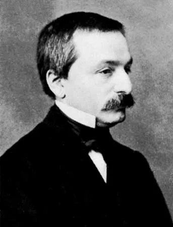

# 레오폴트 크로네커

위 사진은 커먼즈가 1865년으로 적는 작가 미상의 상이다[8].

## TL;DR

- **「정수는 신이 만들었고, 나머지는 모두 사람이 만든 것」.** 그를 기억하게 하는 말이다[1][2].
- **그 말은 남이 옮겼다.** 위키백과는 그것을 베버가 인용한 말로 적고[2], 출처를 베버(1893)를 따라 **1886년** 베를린 자연과학자 대회 강연으로 적는다[3]. 그는 1891년에 죽었으니, 그 인용은 그가 죽고 2년 뒤의 글에 있다(셈 — 1893 − 1891). 그 자신의 글에서 이 말을 찾았다고 적는 출처는 없다(이 노트의 읽기).
- **자리 없이 21년.** 그는 1862년부터 학술원 회원의 권리로 베를린 대학에서 강의했고, 교수가 된 것은 쿠머가 은퇴한 1883년이다[1][2]. 1883 − 1862 = 21 (셈).
- **막으려 한 것.** 1870년 하이네의 논문, 1877년 칸토어의 논문[1]. 국내 인명사전은 칸토어의 베를린 초빙이 그의 「엄중한 반대」로 실현되지 못했다고 적는다[5]. MacTutor 는 그 반대가 개인 감정이 아니었다고 본다[1].
- 이 서가에서 그는 아홉 노트에 이름만 나온다(이 노트를 쓰기 전 2026-11-04 에 센 값, 이 노트의 셈).

---

## 1. 쿠머의 학생

1823년 12월 7일 리그니츠(오늘 폴란드 레그니차)의 부유한 유대인 집안에서 났다[1][2]. MacTutor 는 그가 죽기 한 해 전에 기독교로 개종했다고 적는다[1].

리그니츠 김나지움에서 그를 가르친 사람이 [[에른스트 쿠머]]였다. 쿠머는 그의 재능을 곧 알아보고 학교 수준을 훨씬 넘어 연구로 이끌었다[1]. 쿠머의 전기는 그 김나지움의 가장 유명한 제자로 크로네커와 요아힘스탈을 든다[4]. 위키백과는 그를 쿠머의 **제자이자 평생 친구**로 적는다[2].

- **1841** 베를린 대학에서 [[페터 구스타프 르죈 디리클레]]와 슈타이너에게 배웠다. 수학만이 아니라 천문 · 기상 · 화학, 그리고 데카르트 · 라이프니츠 · 칸트 · 스피노자 · 헤겔의 철학을 공부했다[1].
- **1843~44년 겨울** 옛 스승 쿠머가 있는 브레슬라우로 갔다[1].
- **1845년 7월 30일** 디리클레 지도로 학위논문 「복소 단수에 관하여」를 냈다. 구술시험에서는 천문 관측의 확률론, 정적분, 급수, 미분방정식, 그리고 **그리스어와 철학사**까지 물었다[1].

## 2. 은행과 농장 — 학위 뒤 1855년까지

학위를 받은 그는 학계로 가지 않았다. 여기서 두 자료가 집안 사정을 다르게 적는다.

| 자료 | 그가 맡은 일과 결혼 |
|---|---|
| MacTutor | **외삼촌**의 은행 일을 돕고, 1848년 그 외삼촌의 딸 파니 프라우스니처와 결혼했으며, 집안 영지도 관리했다 [1] |
| 위키백과 | **어머니의 삼촌**(전직 은행가)이 일군 큰 **농장**을 관리했고, 1848년 사촌 파니 프라우스니처와 결혼해 여섯 자녀를 두었다 [2] |

MacTutor 는 그 몇 해 동안에도 그가 순전히 **즐거움으로** 수학을 했다고 적고[1], 위키백과는 그가 쿠머와 편지를 주고받았지만 **결과를 내지 않다가** 1853년 갈루아의 방정식 이론을 넓힌 논문을 썼다고 적는다[2].

**1855년** 그는 베를린으로 돌아왔다. 사업 덕에 넉넉했고[2], MacTutor 는 그가 **대학 자리를 원하지 않았다** — 대학의 수학 생활에 끼어 다른 수학자들과 연구하고 싶었을 뿐 — 고 적는다[1].

## 3. 학술원 회원의 권리로

1855년 쿠머가 디리클레의 뒤를 이어 베를린에 왔고, 1856년 [[카를 바이어슈트라스]]가 왔다. MacTutor 는 쿠머 · 보르하르트 · 바이어슈트라스 · 크로네커의 「놀라운 팀」이 그가 돌아온 지 한 해 안에 모였다고 적는다[1].

- **1860** 쿠머가 그를 베를린 학술원 회원으로 추천하고, 보르하르트와 바이어슈트라스가 재청했다[1].
- **1861년 1월 23일** 학술원 회원이 됐다[1]. 위키백과는 해만 적는다[2].
- 학술원 회원에게는 베를린 대학에서 강의할 **권리**가 있었다. 쿠머의 권유로 그는 **1862년 10월**부터 그 권리로 강의했다 — 대학에도, 다른 어떤 기관에도 고용되지 않은 채로[1].

![그림 위쪽에 「자리 없이 가르치고, 남이 옮긴 한마디 크로네커」라는 표제가 있고 그 아래에 갈색은 크로네커의 자리와 일, 푸른색은 다른 사람이 한 일, 빈 점은 자료마다 해가 다른 자리라고 적혀 있다. 가로축에 1840부터 1890까지 10년마다 눈금이 있다. 줄이 셋 있다. 첫 줄 자리에는 1845 박사 갈색 점, 1848~1855 집안 사업이라는 옅은 갈색 띠, 1861 학술원 갈색 점, 1862~1883 대학 직함 없이 강의라는 갈색 점선 칸, 1883 교수 갈색 점이 있고, 그 아래 1866 과 1868 자리에 빈 점 둘과 괴팅겐 자리 거절 (1866 · 1868)이 적혀 있다. 둘째 줄 막으려 한 것에는 1870 하이네 논문과 1877 칸토어 논문이 푸른 점, 1880 크렐레 편집과 1886 공개 반대 · 린데만이 갈색 점이다. 셋째 줄 「정수는 신이 만들었다」에는 1886 강연에서 했다고라는 빈 갈색 점과 1893 베버가 적다라는 푸른 점이 갈색 점선으로 이어진다. 1891 에 세 줄을 가로지르는 세로 점선이 있고 위에 1891 죽음이라고 적혀 있다. 맨 아래에 단서가 셋 있다. 첫째, 괴팅겐 제안은 MacTutor 가 1868, 위키백과가 리만이 죽은 1866 으로 적고 집안 사업의 끝은 베를린으로 돌아온 1855 로 두었다. 둘째, 「1886 강연에서 했다」는 위키백과가 베버(1893)를 따라 적은 것이고 MacTutor 는 해 없이 「잘 알려진 말」로 적는다. 셋째, 점선은 강연(베버에 따르면)과 베버의 글 사이의 거리이고 이 그림은 그가 그 말을 그대로 했는지 정하지 않는다](../../assets/figures/kronecker-no-chair-borrowed-words.svg)

**괴팅겐을 거절하다.** 가우스와 디리클레가 있던 괴팅겐의 자리를 그는 거절했다. MacTutor 는 그 해를 **1868**[1], 위키백과는 리만이 죽은 **1866**으로 적는다[2].

**1883년** 쿠머가 은퇴하자 그는 비로소 **교수**가 되었고, 1861년 쿠머와 바이어슈트라스가 세운 세미나의 공동 책임자가 됐다[1][2].

그의 강의는 뛰어난 학생에게는 자극이었지만 평범한 학생에게는 인기가 없었다 — 「그의 생각의 비약을 따라갈 수 있는 사람은 몇뿐이었고, 학기 끝까지 버틴 사람도 몇뿐이었다」[1].

## 4. 정수와 유한 번의 단계

MacTutor 는 그가 모든 수학을 **정수와 유한 번의 단계**로 줄여야 한다고 믿었고, 비구성적 존재 증명의 의미를 의심한 **첫 사람**이었다고 적는다[1].

- **1870년대 초부터** 무리수, 상한 · 하한, 볼차노-바이어슈트라스 정리에 반대한 **것으로 보인다**[1].
- 그 철학에 따르면 **초월수는 존재할 수 없었다**[1].
- **1886년**에야 그 견해를 공개했다. 그해 강연에서 그는 린데만의 π 초월성 증명(1882)을 「아름답지만 아무것도 증명하지 않는」 증명이라 했다 — 초월수는 없으니까[1].
- **1887년** 「수 개념에 관하여」에서 정수로부터 유한 번의 연산으로 만들 수 있는 대상만 다루자는 계획을 밝혔다[1].

**구성적인 정리.** 국내 수학백과의 「크로네커의 확대체 정리」는 다항식의 근을 담은 확대체를, 근에 대한 **선험적 지식 없이 다항식으로 구성적으로** 만드는 방법을 준다는 데 그 정리의 큰 의미가 있다고 적는다 — x² − 2 에서 √2 를, x² + 1 에서 i 를 만든다[6]. 그의 철학과 그의 이름이 붙은 정리가 같은 방향을 가리킨다(이 노트의 읽기). 두 대상이 같으면 1, 다르면 0 을 주는 **크로네커 델타**에도 그의 이름이 붙어 있다[7].

위키백과는 그가 [[리하르트 데데킨트]]의 아이디얼 이론을 **철학적 이유로** 받아들이지 않고 약수 이론을 따로 내놓았다고 적는다[2].

## 5. 막으려 한 것들

| 해 | 일 | 근거 |
|---|---|---|
| 1870 | [[에두아르트 하이네]]에게 삼각급수 논문을 크렐레 저널에서 **철회하라고** 설득하려 했다 | [1] |
| 1877 | [[게오르크 칸토어]]의 논문이 크렐레 저널에 실리는 것을 **막으려** 했다 | [1] |
| 1880 | 보르하르트가 죽자 크렐레 저널의 **편집**을 맡았다 — 무엇이 실릴지에 대한 영향이 커졌다 | [1] |
| 1886 | 데데킨트 · 칸토어 · 하이네의 무리수 이론에 공개적으로 반대했다 | [1] |

**칸토어의 경우.** 자료가 다르게 적는다.

- MacTutor 는 1877년의 반대가 **칸토어에 대한 개인 감정 때문이 아니었다**고 적는다 — 그런 감정을 일부 칸토어 전기가 시사했지만, 그는 칸토어의 논문이 **존재하지 않는 대상**에 대한 결과를 증명하므로 무의미하다고 믿었다[1].
- 국내 인명사전은 칸토어가 베를린 대학에서 **여러 번 초빙되었으나** 그의 **「엄중한 반대」**로 실현되지 못했다고 적는다[5].
- MacTutor 의 같은 전기는 그가 수학적으로 의견이 다른 사람과 **개인적으로도** 틀어지는 경향이 있었다고 적고[1], 쿠머의 전기도 그가 수학적으로 다른 사람을 개인적으로 거세게 공격했다고 적는다[4].

이 서가의 [[게오르크 칸토어]] 노트는 반대가 실재했다는 것과 그 반대가 병의 원인이었는지를 갈라 적는다. 이 노트도 같은 선을 지킨다 — 반대는 있었고, 그것이 감정이었는지는 자료가 갈린다.

**바이어슈트라스와.** 1875년 무렵 바이어슈트라스와 그가 갈라섰다[4]. 1888년 바이어슈트라스는 더는 함께 일할 수 없다며 스위스로 가려다, 그가 후임 선택에 힘을 쓸 것을 알고 베를린에 남았다[1].

## 6. 그 한마디

> Die ganzen Zahlen hat der liebe Gott gemacht, alles andere ist Menschenwerk.
> 정수는 사랑하는 신이 만들었고, 나머지는 모두 사람의 일이다.

자료가 이 말을 어떻게 적는지 견준다.

| 자료 | 이 말을 |
|---|---|
| MacTutor | 그가 남긴 「잘 알려진 말」로, 해와 출처 없이 [1] |
| 위키백과 「크로네커」 | **베버가** 그가 그렇게 **말했다고 인용**했다 [2] |
| 위키백과 「유한주의」 | 1886년 베를린 자연과학자 대회 강연에서 — **베버(1893) 19쪽에 따르면** [3] |

베버의 글 「레오폴트 크로네커」는 독일수학회 연보 2권(1891~92)에 실려 1893년에 나왔다[3]. 말이 나온 1886년에서 7년, 그가 죽은 1891년에서 2년 뒤다(셈). 이 노트의 출처 가운데 그 자신의 글에서 이 말을 찾았다고 적는 것은 없다(이 노트의 읽기).

## 7. 끝

1890년 독일수학회가 생겼고, 1891년 9월 할레에서 첫 모임이 열렸다. 칸토어는 둘 사이의 깊은 반목에도 독일 수학의 원로에 대한 **존경의 표시로** 그를 연사로 초청했다[1]. 그는 연설하지 못했다 — 그해 여름 아내가 등반 사고로 크게 다쳐 **8월 23일** 죽었다[1]. 그는 아내보다 몇 달을 더 살고 **1891년 12월 29일** 베를린에서 죽었다[1][2].

MacTutor 는 그의 견해가 그 시대에도 오늘도 대부분의 수학자에게 받아들여지지 않지만 **버려지지도 않았다**고 적는다 — 푸앵카레와 브라우어가 그것을 이어 **직관주의**로 발전시켰다[1]. 위키백과는 그의 유한주의를 직관주의의 **선구**로 적는다[2].

## 8. 이 서가의 크로네커

| 노트 | 거기서 그는 |
|---|---|
| [[게오르크 칸토어]] | 베를린에서 강의를 들은 스승이자, 뒤에 맞선 사람 |
| [[에두아르트 하이네]] | 베를린에서 수학을 논한 상대 |
| [[에른스트 쿠머]] | 리그니츠의 제자, 끝까지 남은 친구 |
| [[카를 바이어슈트라스]] | 베를린을 으뜸으로 만든 세 사람 가운데 하나 |
| [[리하르트 데데킨트]] | 1859년 베를린에서 만난 사람, 무한 반대에 데데킨트가 맞선 상대 |

## 9. 자료가 갈리는 자리

| 무엇 | 한쪽 | 다른 쪽 |
|---|---|---|
| 「정수는 신이 만들었다」 | 해 없이 잘 알려진 말 [1] | 베버의 인용 [2] · 1886 강연, 베버(1893)에 따르면 [3] |
| 학위 뒤의 일 | 외삼촌의 은행 · 그 딸과 결혼 · 영지 [1] | 어머니의 삼촌이 일군 농장 · 사촌과 결혼 [2] |
| 사업 시절의 수학 | 즐거움으로 계속 [1] | 결과를 내지 않다가 1853 [2] |
| 괴팅겐 제안 | 1868 [1] | 1866, 리만이 죽은 뒤 [2] |
| 바이어슈트라스와 갈라선 때 | 1875 무렵 [4] | 1877, 칸토어 문제로 ([[카를 바이어슈트라스]] 노트) |
| 스위스행을 고민한 해 | 1888 [1] | 1885 ([[카를 바이어슈트라스]] 노트) |
| 칸토어 반대의 성격 | 개인 감정이 아니라 철학 [1] | 「엄중한 반대」로 초빙 무산 [5] · 다른 사람과 개인적으로 틀어지는 경향 [1][4] |

## 10. 수업에서 쓸 만한 대목

- **√2 를 만드는 법.** 국내 수학백과의 보기대로 x² − 2 의 나머지 계산으로 a + bα 의 곱셈 규칙을 직접 유도해 본다[6]. 「√2 가 있다고 가정하지 않고」 만든다는 것이 무슨 뜻인지 이야기한다.
- **초월수는 있는가.** 린데만의 증명을 「아무것도 증명하지 않는다」고 한 사람의 입장을 학생들이 대변해 본다(§4).
- **유명한 말의 출처 따라가기.** §6 의 표를 주고, 「누가 · 언제 · 어디에 적었나」를 찾아 인용의 신뢰도를 매겨 본다.
- **크로네커 델타.** 행렬의 단위행렬 성분을 δ 로 적어 보며, 같은 사람이 이름을 남긴 가장 단순한 기호를 만난다[7].

## 연보

| 해 | 일 |
|---|---|
| 1823 | 12월 7일 리그니츠에서 나다[1][2] |
| 1841 | 베를린 대학 — 디리클레 · 슈타이너[1] |
| 1845 | 7월 30일 학위논문[1] |
| 1848 | 파니 프라우스니처와 결혼 · 집안 사업[1][2] |
| 1853 | 갈루아 이론을 넓힌 논문[2] |
| 1855 | 베를린으로[1][2] |
| 1861 | 1월 23일 학술원 회원[1][2] |
| 1862 | 10월부터 대학 강의 — 자리 없이[1] |
| 1866/1868 | 괴팅겐 자리를 거절[1][2] |
| 1870 | 하이네 논문 철회 설득[1] |
| 1877 | 칸토어 논문 출판을 막으려 하다[1] |
| 1880 | 크렐레 저널 편집[1] |
| 1883 | 교수 · 세미나 공동 책임자[1][2] |
| 1886 | 견해 공개 · 린데만 비판 · 「정수는 신이」(베버에 따르면)[1][3] |
| 1887 | 「수 개념에 관하여」[1] |
| 1891 | 8월 23일 아내가 죽다 · 12월 29일 베를린에서 죽다[1][2] |
| 1893 | 베버의 글 「레오폴트 크로네커」[3] |

## 이어서 읽을 것

- [[게오르크 칸토어]] — 그가 막으려 한 수학
- [[에른스트 쿠머]] — 스승이자 친구
- [[카를 바이어슈트라스]] — 함께 베를린을 세우고 갈라선 사람
- [[리하르트 데데킨트]] — 아이디얼, 그가 받아들이지 않은 길
- [[19세기]] — 엄밀화와 기초론의 세기
